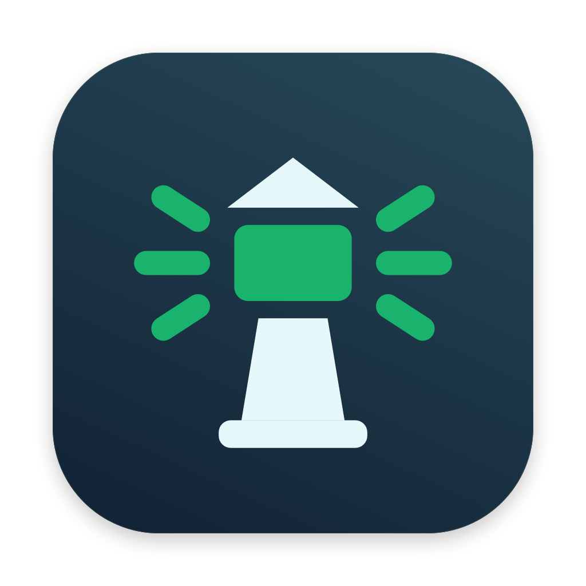

# Uptimelet



A little light for your URLs. Uptimelet is a native macOS menu bar app for monitoring HTTP and HTTPS URLs, with independent schedules and status windows. Runs on macOS 12 Monterey or later, on Intel and Apple silicon (M1 and newer). No third-party dependencies. Released under the [MIT license](LICENSE).

## Build and launch

Requires Xcode 15 or newer, with its command-line tools selected. Open `Uptimelet.xcodeproj` to build and run in Xcode, or use:

```sh
./build.sh
open "$HOME/Desktop/UptimeletExport/Uptimelet.app"
```

`build.sh` archives a Release build and exports an app to the Desktop. The archive is `~/Desktop/Uptimelet.xcarchive`; the app is `~/Desktop/UptimeletExport/Uptimelet.app`. It explicitly builds **both `x86_64` and `arm64`** and verifies the app signature and architectures before finishing. Export copies the app from the archive and signs it locally, so no developer account or export provisioning profile is required.

To put build output in the project instead:

```sh
OUTPUT_ROOT="$PWD/dist" ./build.sh
open dist/UptimeletExport/Uptimelet.app
```

`ARCHIVE_PATH`, `EXPORT_DIR`, and `DERIVED_DATA_PATH` can override individual output paths. For Developer ID signing, set `SIGNING_IDENTITY` to an installed Developer ID Application certificate; that path enables the hardened runtime and a secure timestamp. Notarization is a separate step for public distribution. The default build is signed for local use.

Install by copying `Uptimelet.app` into `/Applications`. The app lives in the menu bar and has no Dock icon. Click its status icon, open **Settings**, and choose **Add URL**. Each URL has an editor for its name, address, automatic polling toggle, polling interval, status window, and request timeout. Click a URL in either the menu bar list or Settings to reopen its editor. There are no preconfigured URLs. You can add the installed app in macOS Login Items if you want it to start when you log in.

## Behavior

- **Green beacon with steady rays:** every active URL passed its latest check, and none failed during its own rolling status window.
- **Amber beacon with broken rays:** every active URL passed its latest check, but at least one failed within its own status window.
- **Red beacon with a crossed lens and no rays:** at least one active URL failed its latest check, even if that failure is older than its status window.
- **Gray beacon with an empty lens:** no active URLs, or at least one URL has not been checked yet. A known latest failure still takes priority and shows red.

Paused URLs use a gray beacon with pause bars. Both shape and color distinguish the states. The original vector artwork is shared by the menu bar, URL list, history, and app icon, and adapts to light and dark appearances.

Each URL polls independently at its own configured interval (default **10 minutes**), starting from the completion of its previous check. Checks also run immediately on launch, after waking from sleep, and when a new or changed address is saved. A URL never has overlapping requests. At most six requests run concurrently across the app; remaining requests wait in a queue. Due times are evaluated every five seconds. macOS does not run checks while the computer is asleep or the app is closed; missed checks are not invented or logged.

The editor's **Check status** button saves current edits, checks **only that URL**, and shows its latest result, error or HTTP status, and response time. It leaves other URLs' schedules and in-progress checks alone. You can manually check a paused URL without enabling automatic polling. The dashboard's **Check now** checks all active URLs. Manual checks restart only the schedules of the URLs they check.

Each URL's status window defaults to **60 minutes**. Windows age automatically while the app runs, so yellow returns to green when old failures leave their respective windows. Each URL's polling interval can be configured from 1 minute to 24 hours; its status window from 1 minute to 7 days; its timeout from 1 to 120 seconds (default 20). Existing saved URLs inherit the previous global settings on first launch of this version; their logs are preserved. New URLs use the default settings.

A check uses an uncached **GET**, follows redirects, and stops once final response headers arrive. HTTP **200–399** is up; HTTP 400–599, DNS/connection errors, invalid TLS certificates, and timeouts are down. Response bodies are not examined. Configure a dedicated health endpoint when you need application health beyond HTTP reachability. HTTP is supported as well as HTTPS; normal TLS validation is preserved for HTTPS.

URLs can have an optional display name and can be paused individually. Paused URLs do not affect the overall status. Editing a URL starts its status fresh; earlier checks remain in history. Removing a URL also preserves its checks until they expire.

## Transfer URLs between Macs

Open **Settings → Export URLs…** to save `Uptimelet-URLs.json`, then transfer the file to another Mac and choose **Settings → Import URLs…** there. The file contains URL addresses, names, enabled states, and each URL's polling interval, status window, and timeout. Check history stays on each Mac.

Import adds new URLs and updates matching URL addresses, preserving local identifiers and history. URLs absent from the file are kept. Re-importing the same file does not create extra entries. New or updated active URLs are checked immediately; paused URLs stay paused and unchanged schedules continue. Intentionally repeated URLs are preserved. Invalid files or failed saves leave the current configuration unchanged.

The export is readable JSON with a format identifier (`uptimelet-urls`), format version (`1`), and an `endpoints` array. You can edit the names, addresses, enabled flags, and numeric settings before importing; the full file is validated before anything is applied.

## Local data and logs

Settings and history are stored in:

```text
~/Library/Application Support/Uptimelet/state.json
```

Each record includes the URL, time, up/down result, HTTP status or error, and response duration. **History** lets you filter by URL or show only failures. Records older than 7 days are removed on launch, after checks, and every five seconds while the app runs, and cleanup is persisted. When the app is closed, cleanup resumes at the next launch. Writes are atomic. A malformed data file is preserved and reported in the popover; it is never silently overwritten. To recover, quit the app and move that file aside before restarting.

Upgrading from Status Check imports `~/Library/Application Support/StatusCheck/state.json` when Uptimelet has no existing data file. The original file is preserved; future writes go to the Uptimelet directory. Quit the old app before launching Uptimelet.

## Tests

```sh
./test.sh
```

Tests cover status precedence, independent status windows and polling intervals, legacy settings migration, single-URL checks, per-URL timeouts, paused manual checks, editor input validation, retention, persistence, HTTP status/error handling, header-only completion, cancellation, concurrency limits, overlapping-request prevention, and stale results after configuration changes. Networking tests use mock responses and direct delegate callbacks. In environments that prohibit nested process sandboxes, use `./test.sh --disable-sandbox` for SwiftPM's manifest runner.

`Sources/UptimeCore` contains models, persistence, and the HTTP checker. `Sources/Uptimelet` contains the polling scheduler and AppKit/SwiftUI interface. The Xcode app target compiles these sources together; SwiftPM separates the core for unit tests.

## Artwork and contributions

The icon's source is `Sources/Uptimelet/BeaconIcon.swift`. To regenerate the app icon and previews after editing the vector drawing:

```sh
./scripts/render-icons.sh
```

See [the status icons in both appearances](Resources/Branding/beacon-states.png). The generated app icon is checked in, so normal builds need no rendering step. Source code and artwork are covered by the MIT license; the license is also bundled inside the app.

Contributions are welcome. Include a description of the behavior being changed and run `./test.sh` and `OUTPUT_ROOT="$PWD/dist" ./build.sh` before submitting a pull request.
